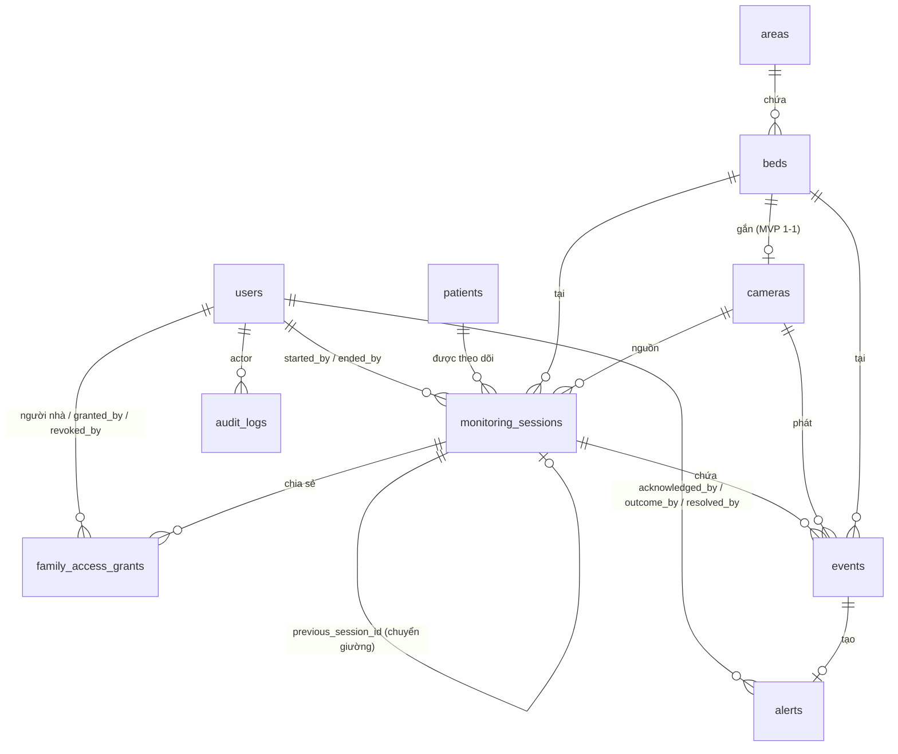

# Data model

Nguồn: PDF §10, §10.1; HS §6.2; QA#31, QA#36; MS §3 (Đề xuất nhóm (POSTCARE-AI-MASTER-SPEC, 17/11/2026)). DB: PostgreSQL 16 ([ADR-0004](decisions/ADR-0004-postgresql.md)).

**Nguyên tắc:**
- Lưu **metadata sự kiện**, không lưu video hay ảnh (PDF §10, §11; HS §3).
- Bệnh nhân chỉ có **mã thử nghiệm** (PDF §10.1; HS §6.3).
- Audit log chỉ thêm, không sửa (PDF §10.1).

Mỗi bảng được tạo bằng migration Alembic **trong feature tương ứng** (cột "Tạo ở").

## ERD

## Bảng

### users (F01)

| Cột | Kiểu | Ràng buộc | Ghi chú |
|---|---|---|---|
| id | bigint PK | | |
| username | text | unique, not null | Chữ thường, 3–64 ký tự `[a-z0-9._-]`, không sửa sau khi tạo (F35 R5, kiểm tra ở API) |
| full_name | text | not null | Tên hiển thị của nhân viên |
| password_hash | text | not null | pwdlib/bcrypt |
| role | enum `user_role` | not null | `NURSE`, `CHARGE_NURSE`, `DOCTOR`, `ADMIN` (QA#18), `FAMILY` (QA#31; thêm ở F35, migration 0003) |
| is_active | bool | default true | `false` = đã khóa (F35, QA#36) |
| created_at | timestamptz | default now() | |
| token_version | integer | not null, default 0 | Tăng khi ADMIN đặt lại mật khẩu; JWT có `tv` khác giá trị này bị từ chối (F35, migration 0004) |

### patients (F01)

| Cột | Kiểu | Ràng buộc | Ghi chú |
|---|---|---|---|
| id | bigint PK | | |
| code | text | unique, not null | Mã thử nghiệm, ví dụ `BN-001`. **Không** có họ tên hay ảnh |
| note | text | null | Ghi chú tối thiểu |
| is_active | bool | default true | |
| created_at | timestamptz | default now() | |

### beds (F01)

| Cột | Kiểu | Ràng buộc | Ghi chú |
|---|---|---|---|
| id | bigint PK | | |
| code | text | unique, not null | `A01`, `A02`… (HS Hình 3) |
| area_id | FK → areas | not null | Khu vực (PDF §10.1). Thay cột chuỗi `area` của F01 từ migration `0005` (F37): mỗi giá trị `btrim(area)` khác nhau thành một dòng `areas`; `downgrade` khôi phục `area` từ `areas.name` |
| is_active | bool | default true | |
| created_at | timestamptz | default now() | |

### areas (F37)

| Cột | Kiểu | Ràng buộc | Ghi chú |
|---|---|---|---|
| id | bigint PK | | |
| code | text | unique, not null | Ví dụ `HP-1`; migration sinh `KV01`, `KV02`… theo thứ tự chữ cái của `name` từ `beds.area` cũ *(giả định)*. Seed: `KV01` "Khu hậu phẫu" |
| name | text | not null | Tên hiển thị, ví dụ "Hậu phẫu 1" |
| is_active | bool | default true | Xóa mềm (QA#36). Không xóa được khi còn giường đang dùng (`AREA_IN_USE`); giường không gán hoặc khôi phục vào khu vực đã xóa |
| created_at | timestamptz | default now() | |

### cameras (F01)

| Cột | Kiểu | Ràng buộc | Ghi chú |
|---|---|---|---|
| id | bigint PK | | |
| name | text | not null | |
| bed_id | bigint FK → beds | unique, null | MVP: 1 camera / giường. Xóa (mềm) camera đặt về null (F03) |
| source_type | enum `camera_source_type` | not null | `WEBCAM`, `URL`, `FILE` |
| source | text | not null | Index webcam, URL (`http://<ip>:4747/video`…), hoặc đường dẫn file |
| roi_polygon | jsonb | null | `[[x,y],…]`, x,y ∈ [0,1], ≥3 điểm, không tự cắt (F08) |
| thresholds | jsonb | default `{}` | Override ngưỡng của [engine](event-engine.md#6-cấu-hình-và-ngưỡng-mặc-định) |
| display_mode | enum `display_mode` | default `BLUR` | `RAW`, `BLUR`, `SKELETON` (F28; A08) |
| config_version | int | default 1 | Tăng mỗi lần sửa cấu hình (worker poll). F03: tăng khi `source_type`, `source` hoặc `bed_id` đổi giá trị (kể cả xóa camera đang gắn giường); đổi `name` thì không |
| status | enum `camera_status` | default `UNKNOWN` | `ONLINE`, `OFFLINE`, `UNKNOWN` |
| last_seen_at | timestamptz | null | Heartbeat gần nhất |
| last_config_hash | text | not null, default `''` | Prototype (ADR-0010, migration 0002): hash cấu hình ngưỡng gần nhất worker gửi lên; dùng cho `events.config_hash` của sự kiện camera do API sinh |
| is_active | bool | default true | |

### monitoring_sessions (F01, logic ở F04)

| Cột | Kiểu | Ràng buộc | Ghi chú |
|---|---|---|---|
| id | bigint PK | | |
| patient_id | FK → patients | not null | |
| bed_id | FK → beds | not null | |
| camera_id | FK → cameras | null | Lấy theo giường khi mở phiên |
| started_at | timestamptz | not null | |
| started_by | FK → users | not null | |
| ended_at | timestamptz | null | null = đang mở |
| ended_by | FK → users | null | |
| previous_session_id | FK → monitoring_sessions | unique, null | Phiên trước trong chuỗi chuyển giường (F04) |
| transfer_reason | text | null | Lý do chuyển giường, có khi `previous_session_id` khác null (F04) |
| paused_at | timestamptz | null | null = không tạm dừng thu hình (F36) |
| paused_by | FK → users | null | Người tạm dừng (F36); lịch sử tạm dừng/tiếp tục nằm trong audit |

Ràng buộc:
- `UNIQUE (bed_id) WHERE ended_at IS NULL`
- `UNIQUE (patient_id) WHERE ended_at IS NULL`
- `UNIQUE (previous_session_id)`: chuỗi chuyển giường tuyến tính (F04)

### family_access_grants (F36)

| Cột | Kiểu | Ràng buộc | Ghi chú |
|---|---|---|---|
| id | bigint PK | | |
| session_id | FK → monitoring_sessions | not null | Quyền gắn với phiên, không chuyển sang phiên mới |
| user_id | FK → users | not null | Tài khoản vai trò `FAMILY` |
| share_level | enum `share_level` | not null, default `INFO` | `INFO`, `SKELETON` (MS §3). Không có mức nào gửi ảnh |
| consent_note | text | not null | Ghi chú chấp thuận chia sẻ (khác chấp thuận quan sát; QA#31) |
| granted_by | FK → users | not null | CHARGE_NURSE hoặc ADMIN |
| granted_at | timestamptz | not null | |
| expires_at | timestamptz | null | null = đến khi phiên kết thúc |
| revoked_at | timestamptz | null | |
| revoked_by | FK → users | null | |

Ràng buộc: `UNIQUE (session_id, user_id) WHERE revoked_at IS NULL`.
Quyền có hiệu lực khi chưa thu hồi, chưa hết hạn, phiên còn mở và tài khoản còn hoạt động với vai trò `FAMILY` (tính lúc truy vấn, F36 R5).

### events (F17)

| Cột | Kiểu | Ràng buộc | Ghi chú |
|---|---|---|---|
| id | bigint PK | | |
| event_uid | uuid | unique, not null | Worker sinh ra; chống trùng |
| session_id | FK → monitoring_sessions | null | null với sự kiện camera khi không có phiên |
| bed_id | FK → beds | null | null chỉ khi sự kiện camera đến từ camera chưa gắn giường *(giả định)* |
| camera_id | FK → cameras | not null | |
| code | enum `event_code` | not null | Xem [catalog](event-engine.md#5-catalog-sự-kiện) |
| priority | enum `priority` | not null | `LOG`, `INFO`, `MEDIUM`, `HIGH` |
| occurred_at | timestamptz | not null | Thời điểm điều kiện bắt đầu được thỏa (theo đồng hồ khung hình) |
| detected_at | timestamptz | not null | Thời điểm engine phát sự kiện |
| created_at | timestamptz | default now() | Thời điểm lưu DB (dùng tính delivery latency) |
| confidence | real | not null | 0–1 |
| observation_quality | enum `observation_quality` | not null | `GOOD`, `LOW_CONFIDENCE`, `MULTIPLE_PEOPLE`, `NO_PERSON`, `CAMERA_ISSUE` |
| explanation | jsonb | not null | Căn cứ ngắn gọn: `rule_id`, giá trị đặc trưng chính (HS §6.2) |
| config_hash | text | not null, default `''` | Hash cấu hình ngưỡng đang dùng (truy vết khi đánh giá). Sự kiện camera do API sinh: hash gần nhất worker gửi, hoặc chuỗi rỗng |

Index: `(session_id, occurred_at)`, `(bed_id, occurred_at)`.

### alerts (F17, logic ở F19)

| Cột | Kiểu | Ràng buộc | Ghi chú |
|---|---|---|---|
| id | bigint PK | | |
| event_id | FK → events | unique, not null | |
| status | enum `alert_status` | default `PENDING` | `PENDING`, `ACKNOWLEDGED`, `RESOLVED` |
| outcome | enum `alert_outcome` | null | `CONFIRMED`, `FALSE_ALARM`, `PATIENT_SAFE`; null = chưa ghi |
| note | text | null | |
| acknowledged_by / acknowledged_at | FK users / timestamptz | null | |
| outcome_by / outcome_at | FK users / timestamptz | null | |
| resolved_by / resolved_at | FK users / timestamptz | null | |
| created_at | timestamptz | default now() | |

Index: `(status, created_at)`.

### audit_logs (F01)

| Cột | Kiểu | Ràng buộc | Ghi chú |
|---|---|---|---|
| id | bigint PK | | |
| actor_user_id | FK → users | null | null = hệ thống/worker |
| action | text | not null | Ví dụ `session.start`, `session.transfer`, `session.pause`, `alert.acknowledge`, `camera.update_roi`, `bed.delete`, `bed.restore`, `user.lock`, `family_access.grant`, `family_access.view` |
| entity_type | text | not null | `session`, `alert`, `camera`, `bed`, `patient`, `user`, `area`, `shift`, `family_access_grant`… |
| entity_id | bigint | not null | |
| before / after | jsonb | null | Ảnh chụp các trường thay đổi |
| created_at | timestamptz | default now() | |

Bảng chỉ INSERT; code không có hàm update hay delete.

### shift_definitions (F01, CRUD ở F37)

| Cột | Kiểu | Ghi chú |
|---|---|---|
| id | bigint PK | |
| name | text | "Ca sáng", "Ca chiều", "Ca đêm"; duy nhất trong các ca đang dùng (F37) |
| start_time / end_time | time | Seed 06:00–14:00, 14:00–22:00, 22:00–06:00 *(giả định QA#19)*; ca đêm vắt qua nửa đêm. Các ca đang dùng không chồng giờ (F37) |
| is_active | bool | default true; thêm ở F37 (xóa mềm, QA#36) |
| created_at | timestamptz | default now(); thêm ở F37 |

## Dữ liệu không lưu trong DB

| Dữ liệu | Ở đâu | Lý do |
|---|---|---|
| Trạng thái cơ thể hiện tại của giường | RAM của API (cập nhật từ worker), phát qua WS `bed.state` | Thay đổi liên tục; chỉ lưu sự kiện |
| Keypoint mới nhất của người mục tiêu | RAM của API (từ `target_keypoints` của worker), phát qua WS `family.skeleton` (F36) | Chỉ khi có quyền mức `SKELETON`; không lưu |
| Khung hình xem trực tiếp | RAM của API (chỉ khung mới nhất) | Không lưu ảnh (QA#29) |
| Video test, ground truth | `data/` (gitignore) | Có quyền sử dụng; không đưa vào git |
| Kết quả replay/eval | `runs/`, `reports/` | Artefact dev |

## Quy ước

- Thời gian lưu UTC (`timestamptz`). UI hiển thị `Asia/Ho_Chi_Minh`, định dạng `HH:mm:ss` (PDF §9.3).
- Enum là kiểu enum native của PostgreSQL (`user_role`, `camera_source_type`…), phải khớp enum trong `postcare.schemas`. Có test so sánh `pg_enum` với Python (`server/tests/db/test_enums_match.py`, F01; F10, F17 bổ sung). Thêm giá trị enum cần migration mới (`ALTER TYPE … ADD VALUE`).
- Cột có `default` cũng là `NOT NULL`, trừ cột ghi rõ `null` *(giả định F01)*. Kiểu: id/FK `bigint`, chuỗi `text`, JSON `jsonb`, thời gian `timestamptz`.
- Tên constraint theo quy ước trong `postcare/db/base.py` (`pk_<bảng>`, `uq_<bảng>_<cột>`, `fk_<bảng>_<cột>_<bảng đích>`), để migration sau tham chiếu được.
- Mọi thay đổi schema đi qua migration Alembic (`server/src/postcare/db/migrations/`). Không sửa migration đã merge. Test `test_models_match_migrations` báo lỗi khi model và migration lệch nhau.
- Migration hiện có: `0001` (F01: 7 bảng nền), `0002` (prototype ADR-0010: `events`, `alerts` theo mục tương ứng ở trên và cột `cameras.last_config_hash`; F17 tiếp nhận bằng migration mới), `0003` (F35: thêm `FAMILY` vào `user_role`; downgrade dừng nếu còn tài khoản `FAMILY`), `0004` (F35: `users.token_version`).
- Trạng thái cơ thể không lưu từng lần đổi. "Số lần đổi trạng thái" ở bàn giao ca (PDF §9.1) đếm qua các sự kiện tư thế/vị trí (F24) *(giả định)*.
- Xóa mềm (`is_active = false`) với bảng danh mục (`beds`, `patients`, `cameras`, `areas`, `shift_definitions`, `users`), có khôi phục (QA#36). Không xóa cứng bất kỳ bảng nào; không xóa cứng sự kiện, cảnh báo hay audit. Bản ghi đã xóa vẫn giữ lịch sử, timeline, audit. Mã (`code`, `username`) duy nhất kể cả bản ghi đã xóa.
