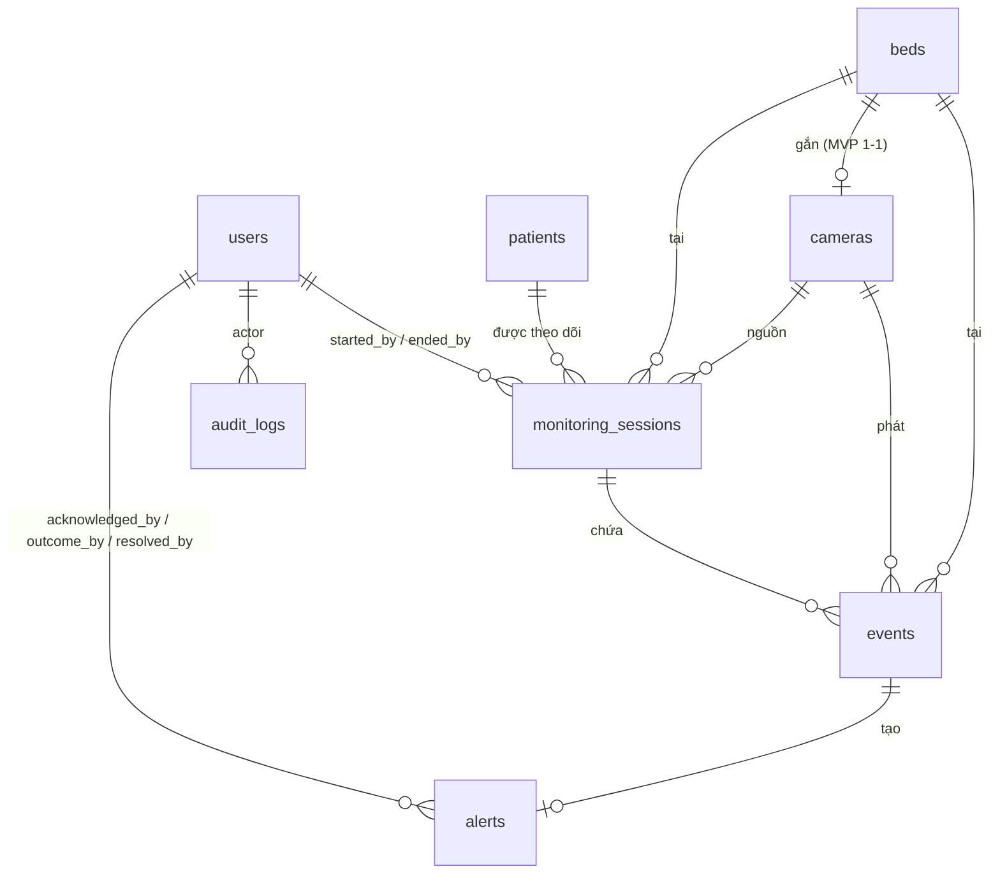

# Data model

Nguồn: PDF §10, §10.1; HS §6.2. DB: PostgreSQL 16 ([ADR-0004](decisions/ADR-0004-postgresql.md)).

**Nguyên tắc:**
- Lưu **metadata sự kiện**, không lưu video hay ảnh (PDF §10, §11; HS §3).
- Bệnh nhân chỉ có **mã thử nghiệm** (PDF §10.1; HS §6.3).
- Audit log chỉ thêm, không sửa (PDF §10.1).

Mỗi bảng được tạo bằng migration Alembic **trong feature tương ứng** (cột "Tạo ở").

## ERD

## Bảng

### users (F01)

| Cột | Kiểu | Ràng buộc | Ghi chú |
|---|---|---|---|
| id | bigint PK | | |
| username | text | unique, not null | |
| full_name | text | not null | Tên hiển thị của nhân viên |
| password_hash | text | not null | pwdlib/bcrypt |
| role | enum `user_role` | not null | `NURSE`, `CHARGE_NURSE`, `DOCTOR`, `ADMIN` (QA#18) |
| is_active | bool | default true | |
| created_at | timestamptz | default now() | |

### patients (F01)

| Cột | Kiểu | Ràng buộc | Ghi chú |
|---|---|---|---|
| id | bigint PK | | |
| code | text | unique, not null | Mã thử nghiệm, ví dụ `BN-001`. **Không** có họ tên hay ảnh |
| note | text | null | Ghi chú tối thiểu |
| is_active | bool | default true | |
| created_at | timestamptz | default now() | |

### beds (F01)

| Cột | Kiểu | Ràng buộc | Ghi chú |
|---|---|---|---|
| id | bigint PK | | |
| code | text | unique, not null | `A01`, `A02`… (HS Hình 3) |
| area | text | not null | Khu vực (PDF §10.1) |
| is_active | bool | default true | |
| created_at | timestamptz | default now() | |

### cameras (F01)

| Cột | Kiểu | Ràng buộc | Ghi chú |
|---|---|---|---|
| id | bigint PK | | |
| name | text | not null | |
| bed_id | bigint FK → beds | unique, null | MVP: 1 camera / giường |
| source_type | enum `camera_source_type` | not null | `WEBCAM`, `URL`, `FILE` |
| source | text | not null | Index webcam, URL (`http://<ip>:4747/video`…), hoặc đường dẫn file |
| roi_polygon | jsonb | null | `[[x,y],…]`, x,y ∈ [0,1], ≥3 điểm, không tự cắt (F08) |
| thresholds | jsonb | default `{}` | Override ngưỡng của [engine](event-engine.md#6-cấu-hình-và-ngưỡng-mặc-định) |
| display_mode | enum `display_mode` | default `BLUR` | `RAW`, `BLUR`, `SKELETON` (F28; A08) |
| config_version | int | default 1 | Tăng mỗi lần sửa cấu hình (worker poll) |
| status | enum `camera_status` | default `UNKNOWN` | `ONLINE`, `OFFLINE`, `UNKNOWN` |
| last_seen_at | timestamptz | null | Heartbeat gần nhất |
| is_active | bool | default true | |

### monitoring_sessions (F01, logic ở F04)

| Cột | Kiểu | Ràng buộc | Ghi chú |
|---|---|---|---|
| id | bigint PK | | |
| patient_id | FK → patients | not null | |
| bed_id | FK → beds | not null | |
| camera_id | FK → cameras | null | Lấy theo giường khi mở phiên |
| started_at | timestamptz | not null | |
| started_by | FK → users | not null | |
| ended_at | timestamptz | null | null = đang mở |
| ended_by | FK → users | null | |

Ràng buộc:
- `UNIQUE (bed_id) WHERE ended_at IS NULL`
- `UNIQUE (patient_id) WHERE ended_at IS NULL`

### events (F17)

| Cột | Kiểu | Ràng buộc | Ghi chú |
|---|---|---|---|
| id | bigint PK | | |
| event_uid | uuid | unique, not null | Worker sinh ra; chống trùng |
| session_id | FK → monitoring_sessions | null | null với sự kiện camera khi không có phiên |
| bed_id | FK → beds | null | null chỉ khi sự kiện camera đến từ camera chưa gắn giường *(giả định)* |
| camera_id | FK → cameras | not null | |
| code | enum `event_code` | not null | Xem [catalog](event-engine.md#5-catalog-sự-kiện) |
| priority | enum `priority` | not null | `LOG`, `INFO`, `MEDIUM`, `HIGH` |
| occurred_at | timestamptz | not null | Thời điểm điều kiện bắt đầu được thỏa (theo đồng hồ khung hình) |
| detected_at | timestamptz | not null | Thời điểm engine phát sự kiện |
| created_at | timestamptz | default now() | Thời điểm lưu DB (dùng tính delivery latency) |
| confidence | real | not null | 0–1 |
| observation_quality | enum `observation_quality` | not null | `GOOD`, `LOW_CONFIDENCE`, `MULTIPLE_PEOPLE`, `NO_PERSON`, `CAMERA_ISSUE` |
| explanation | jsonb | not null | Căn cứ ngắn gọn: `rule_id`, giá trị đặc trưng chính (HS §6.2) |
| config_hash | text | not null, default `''` | Hash cấu hình ngưỡng đang dùng (truy vết khi đánh giá). Sự kiện camera do API sinh: hash gần nhất worker gửi, hoặc chuỗi rỗng |

Index: `(session_id, occurred_at)`, `(bed_id, occurred_at)`.

### alerts (F17, logic ở F19)

| Cột | Kiểu | Ràng buộc | Ghi chú |
|---|---|---|---|
| id | bigint PK | | |
| event_id | FK → events | unique, not null | |
| status | enum `alert_status` | default `PENDING` | `PENDING`, `ACKNOWLEDGED`, `RESOLVED` |
| outcome | enum `alert_outcome` | null | `CONFIRMED`, `FALSE_ALARM`, `PATIENT_SAFE`; null = chưa ghi |
| note | text | null | |
| acknowledged_by / acknowledged_at | FK users / timestamptz | null | |
| outcome_by / outcome_at | FK users / timestamptz | null | |
| resolved_by / resolved_at | FK users / timestamptz | null | |
| created_at | timestamptz | default now() | |

Index: `(status, created_at)`.

### audit_logs (F01)

| Cột | Kiểu | Ràng buộc | Ghi chú |
|---|---|---|---|
| id | bigint PK | | |
| actor_user_id | FK → users | null | null = hệ thống/worker |
| action | text | not null | Ví dụ `session.start`, `alert.acknowledge`, `camera.update_roi` |
| entity_type | text | not null | `session`, `alert`, `camera`… |
| entity_id | bigint | not null | |
| before / after | jsonb | null | Ảnh chụp các trường thay đổi |
| created_at | timestamptz | default now() | |

Bảng chỉ INSERT; code không có hàm update hay delete.

### shift_definitions (F01)

| Cột | Kiểu | Ghi chú |
|---|---|---|
| id | bigint PK | |
| name | text | "Ca sáng", "Ca chiều", "Ca đêm" |
| start_time / end_time | time | Seed 06:00–14:00, 14:00–22:00, 22:00–06:00 *(giả định QA#19)*; ca đêm vắt qua nửa đêm |

## Dữ liệu không lưu trong DB

| Dữ liệu | Ở đâu | Lý do |
|---|---|---|
| Trạng thái cơ thể hiện tại của giường | RAM của API (cập nhật từ worker), phát qua WS `bed.state` | Thay đổi liên tục; chỉ lưu sự kiện |
| Khung hình xem trực tiếp | RAM của API (chỉ khung mới nhất) | Không lưu ảnh (QA#29) |
| Video test, ground truth | `data/` (gitignore) | Có quyền sử dụng; không đưa vào git |
| Kết quả replay/eval | `runs/`, `reports/` | Artefact dev |

## Quy ước

- Thời gian lưu UTC (`timestamptz`). UI hiển thị `Asia/Ho_Chi_Minh`, định dạng `HH:mm:ss` (PDF §9.3).
- Enum trong DB phải khớp enum trong `postcare.schemas`. Có test so sánh (F10, F17).
- Mọi thay đổi schema đi qua migration Alembic (`server/src/postcare/db/migrations/`). Không sửa migration đã merge.
- Trạng thái cơ thể không lưu từng lần đổi. "Số lần đổi trạng thái" ở bàn giao ca (PDF §9.1) đếm qua các sự kiện tư thế/vị trí (F24) *(giả định)*.
- Xóa mềm (`is_active = false`) với bảng danh mục. Không xóa cứng sự kiện, cảnh báo hay audit.
