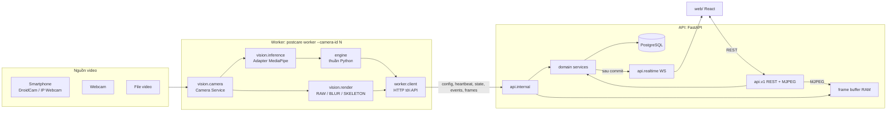
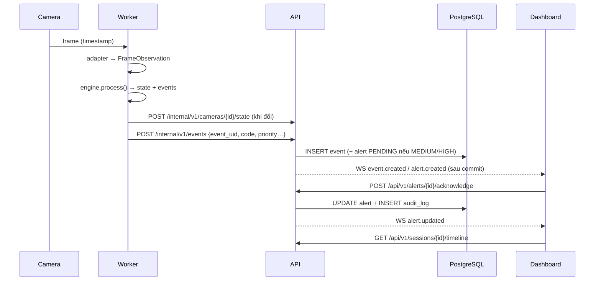
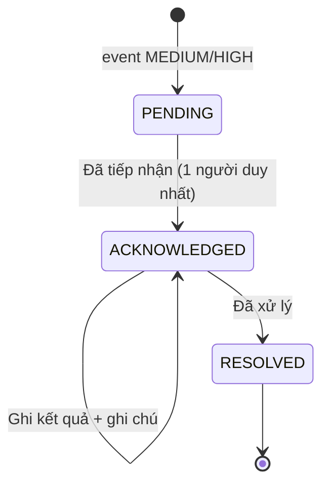
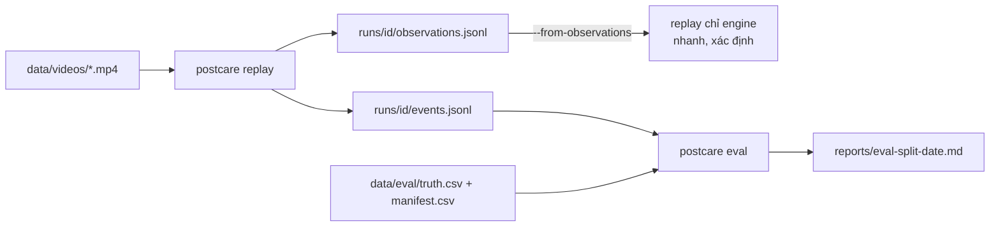

# Kiến trúc tổng quan

Nguồn: PDF §5, §10; HS §4.2, §6.1. Quyết định chính: [ADR-0001](decisions/ADR-0001-modular-monolith.md), [ADR-0002](decisions/ADR-0002-worker-http-internal-api.md), [ADR-0003](decisions/ADR-0003-mediapipe-pretrained-adapter.md).

## 1. Hình dạng hệ thống

**Modular monolith chạy trên một máy** (HS §6.1). Gồm 3 phần:

| Tiến trình | Lệnh | Nhiệm vụ |
|---|---|---|
| API | `make dev-api` (`uvicorn postcare.api.main:app`) | REST, WebSocket, MJPEG, nghiệp vụ, DB |
| Worker (1 tiến trình / camera) | `make worker CAMERA=1` (`postcare worker --camera-id 1`) | Đọc camera → AI → engine → gửi kết quả lên API |
| Web | `make dev-web` (Vite) | Dashboard tiếng Việt |

Tách worker khỏi API vì hai lý do:
- AI tốn CPU, nên tách ra để API không bị chậm.
- Worker lỗi (camera rớt, model lỗi) không làm sập API.

Đây cũng là đơn vị có thể nhân bản khi chạy nhiều camera (F31).

## 2. Sơ đồ thành phần

## 3. Module trong `server/src/postcare/`

| Module | Trách nhiệm (HS §6.1) | Được import | **Không** được import |
|---|---|---|---|
| `schemas` | Kiểu dữ liệu và cấu hình dùng chung: `FrameObservation`, `PersonPose`, `FaceObservation` (output adapter), `FaceSignals` (tín hiệu engine suy ra), `EngineOutput`, `EventCode`, `Priority`, `BodyState`, enum (`schemas/enums.py`), `EngineConfig` + đọc YAML (`schemas/engine_config.py`), kiểm tra polygon ROI (`schemas/roi.py`) | stdlib, pydantic, pyyaml | mọi module khác |
| `engine` | Temporal Processing + Event Engine: chọn người mục tiêu, đặc trưng, làm mượt, state machine, rule, vận động, khuôn mặt | `schemas`, stdlib, pydantic, numpy | cv2, mediapipe, fastapi, sqlalchemy, httpx, `vision`, `api`, `db` |
| `vision` | Camera Service (`vision.camera`), AI Inference adapter (`vision.inference`, **nơi duy nhất import mediapipe**), render khung hình (`vision.render`) | `schemas`, cv2, mediapipe, numpy | `api`, `db`, `engine` |
| `pipeline` | Ghép `vision` + `engine` cho một khung hình (dùng chung bởi worker và replay, để offline phản ánh đúng realtime) | `vision`, `engine`, `schemas` | `api`, `db` |
| `worker` | Vòng lặp realtime: `pipeline` + HTTP client tới API | `pipeline`, `vision`, `engine`, `schemas`, httpx | `api`, `db` |
| `replay` / `eval` | Chạy offline trên file video; tính metric từ file JSONL/CSV | `pipeline`, `vision`, `engine`, `schemas` | `api`, `db` |
| `db` | SQLAlchemy model, session, Alembic (`db/migrations/`, chạy từ code qua `db/migrate.py`) | sqlalchemy, alembic, `schemas` (enum), `settings` (URL cho Alembic) | `api`, `vision`, `engine` |
| `domain` | Nghiệp vụ: phiên, sự kiện → cảnh báo, vòng đời cảnh báo, audit, timeline, bàn giao ca, chỉ số workflow (F29) | `db`, `schemas` | `api`, `vision`, `engine` |
| `api` | FastAPI routers (`api.v1`, `api.internal`), auth, realtime gateway, frame buffer, kho trạng thái giường trong RAM | `domain`, `db`, `schemas` | `vision`, `engine` |
| `cli` | Lệnh Typer: `worker`, `probe`, `replay`, `eval`, `seed`, `measure-delivery`, `workflow-report`… | tất cả | — |

Các ranh giới trên được kiểm tra tự động bằng **import-linter** (`server/.importlinter`) trong `make check`.

## 4. Luồng chính: từ khung hình tới timeline

## 5. Vòng đời cảnh báo

Chi tiết ở [ADR-0007](decisions/ADR-0007-alert-status-outcome.md) và spec [F19](../03-features/F19-alert-lifecycle.md).

## 6. Luồng offline (dev và đánh giá)

`replay` dùng **chung** pipeline `vision` + `engine` với worker. Kết quả offline vì vậy phản ánh đúng hành vi realtime (PDF §12: dựng engine trên file video trước).

## 7. Kênh giao tiếp worker ↔ API

Định nghĩa đầy đủ ở [api-conventions.md](api-conventions.md#api-nội-bộ-cho-worker).

| Endpoint nội bộ | Chu kỳ | Mục đích |
|---|---|---|
| `GET /internal/v1/cameras/{id}/config` | khi khởi động + mỗi 5 giây | Nguồn, ROI, ngưỡng, chế độ hiển thị, `config_version`, phiên đang mở |
| `POST /internal/v1/cameras/{id}/heartbeat` | 2 giây | FPS, độ sáng, số frame bỏ, trạng thái nguồn |
| `POST /internal/v1/cameras/{id}/state` | khi trạng thái thay đổi | Trạng thái cơ thể, chất lượng, vận động, nghỉ/hoạt động, tín hiệu mặt |
| `POST /internal/v1/events` | khi có sự kiện | Sự kiện có `event_uid` (idempotent) |
| `POST /internal/v1/cameras/{id}/frame` | ~5 fps | JPEG đã render theo chế độ hiển thị; API chỉ giữ khung mới nhất trong RAM |

Các chu kỳ trên là giả định A02 và A03 trong [qa-decisions.md](../01-product/qa-decisions.md).

## 8. Triển khai

- Một laptop chạy PostgreSQL, API, worker, web; smartphone và laptop cùng mạng Wi-Fi/LAN (HS §7.2).
- Truy cập dashboard từ thiết bị khác qua `http://<ip-laptop>:<port>`.
- Không dùng cloud và HTTPS *(giả định A09)*.
