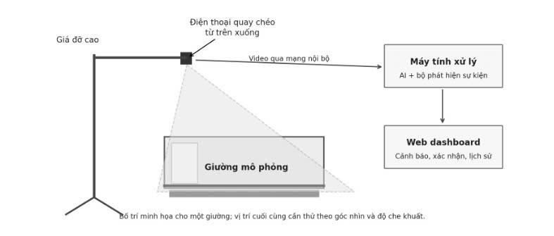

# Bố trí camera cho giường mô phỏng

Nguồn chính: HS §4.1 (ưu tiên). Hình tham khảo: [assets/](../00-source/assets/).

## 1. Yêu cầu (HS §4.1)

- Điện thoại gắn chắc chắn trên **tripod hoặc giá đỡ có tay vươn**, đặt **ở đầu giường hoặc lệch một bên**, hướng **chéo từ trên xuống**.
- Góc quay bao quát **thân người, hai mép giường và vùng người bệnh có thể bước xuống**.
- **Vị trí cuối chọn qua thử nghiệm** landmark và mức che khuất. Không cố định một góc duy nhất cho mọi loại giường.
- Giá đỡ có **ngàm khóa**. Dây sạc bố trí gọn. Có **biện pháp chống rơi** nếu thiết bị vươn qua vùng giường.
- Pose theo dõi liên tục. Face chỉ chạy khi mặt đủ rõ; mất tín hiệu mặt không làm gián đoạn pose.

## 2. Khuyến nghị thêm *(giả định, xác nhận ở buổi thử)*

- **Không đặt thiết bị ngay phía trên mặt hoặc thân người.** Nếu bắt buộc phải vươn qua giường thì phải có dây chống rơi (HS §4.1).
- Tránh góc nhìn **thẳng từ trên xuống**: trên ảnh 2D, nằm và ngồi khó phân biệt.
- Tránh nhìn **dọc theo trục giường**: góc thân kém tin cậy (xem [event-engine.md](../02-architecture/event-engine.md#6-cấu-hình-và-ngưỡng-mặc-định)).
- Gợi ý khởi điểm: ống kính cao khoảng 1,8–2,2 m, nghiêng xuống 30–45°. Khung hình chứa cả mặt giường và dải sàn khoảng 0,8–1 m ở phía bước xuống.
- Chân tripod **không đặt trong vùng bước xuống** hay lối đi (tránh gây vấp).
- Không kẹp giá vào giường bệnh: giường nâng hạ làm camera lệch, khiến Bed ROI sai.
- Quay ngang (landscape), 720p, 15–30 fps.
- Đánh dấu vị trí chân tripod trên sàn bằng băng dính và chụp ảnh tham chiếu. Camera lệch vài cm thì phải vẽ lại ROI.
- Ánh sáng: phòng đủ sáng hoặc có đèn ngủ. Camera điện thoại không có hồng ngoại; phòng tối sẽ dẫn tới "Không đủ dữ liệu quan sát". Ghi rõ điều kiện ánh sáng trong báo cáo đánh giá (PDF §17).

## 3. Checklist buổi thử (tuần 1–2)

1. Dựng giường mô phỏng; đặt tripod theo 2–3 vị trí ứng viên (đầu giường lệch trái, đầu giường lệch phải, giữa cạnh dài…).
2. Ở mỗi vị trí, stream điện thoại lên laptop; chạy `postcare probe` (F05) và, khi đã có F11, `postcare replay --preview`.
3. Người tham gia diễn: nằm, trở mình, ngồi dậy, ngồi mép giường, đứng cạnh giường, bước ra ngoài, quay lại.
4. Ghi lại cho mỗi vị trí:
   - có đủ landmark vai, hông, gối, cổ chân ở mọi tư thế không;
   - giường và dải sàn có nằm trọn trong khung không;
   - kích thước vùng đầu (pixel) khi nằm và khi ngồi;
   - FPS, độ trễ;
   - chạm nhẹ vào giá đỡ thì khung hình có rung/lệch không.
5. Thử thêm 1 lần giảm đèn.
6. Chọn vị trí tốt nhất. Ghi vào bảng dưới và chụp ảnh tổng thể (không có người) lưu ở `data/setup/` (không commit).

## 4. Chuẩn lắp đặt đã chốt

| Mục | Giá trị |
|---|---|
| Ngày thử | — |
| Vị trí so với giường | — |
| Độ cao ống kính | — |
| Góc nghiêng | — |
| Khoảng cách tới mép giường | — |
| Thiết bị / app / độ phân giải / fps | — |
| Kích thước vùng đầu khi nằm (px) | — |
| Ghi chú che khuất, ánh sáng | — |
