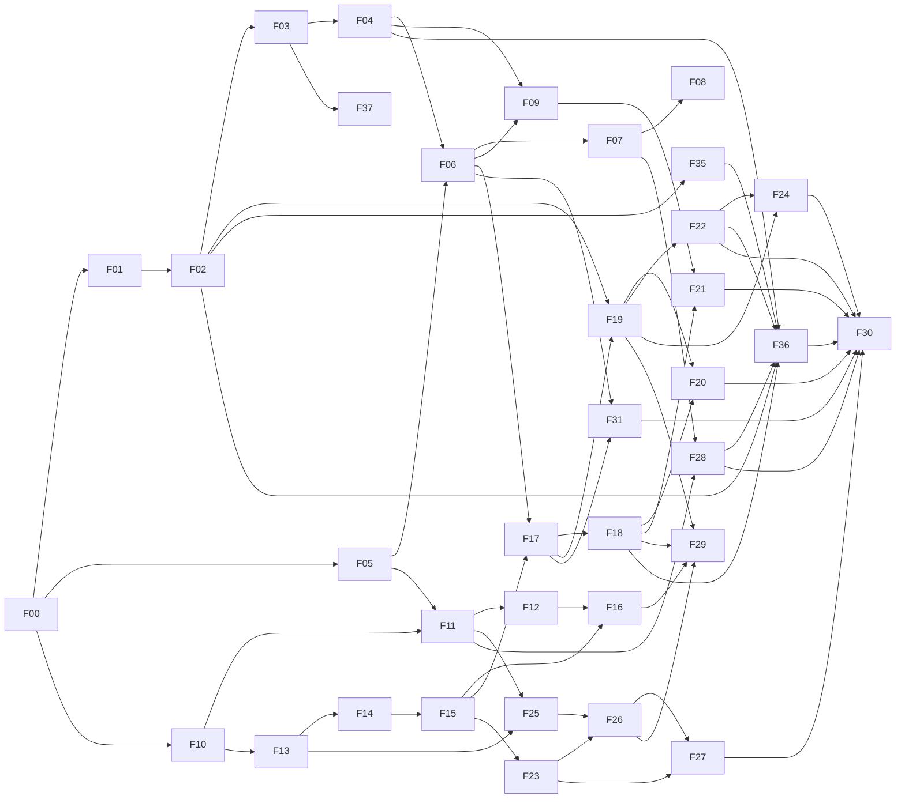

# Roadmap

Lộ trình 10 tuần theo HS §7.3. Ngày bắt đầu tuần 1: **chưa chốt**. Điền khi nhóm bắt đầu F00.

Trạng thái feature: `Todo` → `Planned` → `In progress` → `In review` → `Done` (hoặc `Blocked`).
Cột trạng thái ở bảng dưới phải khớp với spec và với [03-features/README.md](../03-features/README.md).

## Milestone

| Milestone | Tuần | Mục tiêu (HS §7.3) | Feature | Điều kiện kết thúc | Trạng thái |
|---|---|---|---|---|---|
| **M0 Nền tảng** | 1–2 | Camera input, ROI, database, API, dashboard khung, phiên theo dõi, quản lý tài khoản / khu vực / ca trực | F00–F09, F35, F37 | Xem được camera thật trên web, vẽ được ROI, mở được phiên | In progress |
| **M1 Body AI** | 3–4 | Pose, nằm/ngồi/đứng, ngồi dậy, mép giường, rời/quay lại giường | F10–F16 | Replay video dev ra đúng chuỗi sự kiện cơ thể; có báo cáo eval dev đầu tiên | Done |
| **M2 Event + workflow** | 5–6 | Temporal rule, mức ưu tiên, cảnh báo, tiếp nhận, timeline, audit | F17–F24 | **Mốc tối thiểu** (HS §7.3): chạy trọn kịch bản demo chính bằng camera thật | In progress |
| **M3 Face + hoạt động** | 7–8 | Tín hiệu mắt/lông mày/nheo mắt, biểu hiện cần kiểm tra, mức hoạt động tham khảo | F25–F27 | Có tín hiệu mặt khi đủ rõ, FACE_ATTENTION, trạng thái nghỉ/hoạt động | In progress |
| **M4 Đánh giá + demo** | 9–10 | Bộ test, P/R/F1, FP/giờ, latency, privacy mode, người nhà, hai worker đồng thời, demo hoàn chỉnh | F28–F30, F31 (R1–R3), F36 | Báo cáo cuối với ngưỡng đã chốt; E2E xanh; demo chạy ổn 3 lần liên tiếp | Todo |
| Sau MVP | — | Hướng mở rộng HS §9.2 | F31 (phần còn lại), F32–F34 | — | Todo |

**Đường cắt phạm vi:**
- Thiếu thời gian thì dừng sau **M2**: sản phẩm vẫn trọn chuỗi Body AI → sự kiện → cảnh báo → xác nhận → timeline (HS §7.3; PDF §12).
- M3 được thu hẹp theo chất lượng quan sát khuôn mặt.

**Thay đổi thứ tự so với HS** ([ADR-0008](../02-architecture/decisions/ADR-0008-early-eval-tooling.md)): công cụ đánh giá (F12, F16) làm ở M1 để hiệu chỉnh ngưỡng trên tập dev. Đánh giá chính thức vẫn ở M4 (F29).

## Thứ tự theo phụ thuộc

**Làm song song theo nhánh** (PDF §12, QA#3). Sau F00, ba nhánh chạy song song:

| Nhánh | Thứ tự gợi ý |
|---|---|
| A: vision/engine | F05 → F10 → F13 → F14 → F15 → F11 → F12 → F16 → F23 → F25 → F26 → F27 |
| B: backend | F01 → F02 → F35 → F03 → F37 → F04 → F06 → F17 → F19 → F24 → F31 (R1–R3) → F36 → F29 |
| C: frontend/test | (sau F02, F03, F04) F09 → F07 → F08 → F18 (phần client) → F20 → F21 → F22 → F28 → F30 |

F10 và F13–F15 dùng dữ liệu tổng hợp, nên bắt đầu được trước khi có model (F11).

## Trạng thái feature

| Mã | Tên | Milestone | Trạng thái |
|---|---|---|---|
| F00 | Khung xương dự án | M0 | Done |
| F01 | CSDL và migration nền | M0 | Done |
| F02 | Đăng nhập và phân quyền | M0 | Done |
| F03 | Quản lý giường, bệnh nhân, camera | M0 | Done |
| F04 | Phiên theo dõi | M0 | Done |
| F05 | Nguồn video (Camera Service) | M0 | Done |
| F06 | Kết nối worker với backend | M0 | Done |
| F07 | Theo dõi trực tiếp cơ bản | M0 | Done |
| F08 | Cấu hình camera và Bed ROI | M0 | Done |
| F09 | Dashboard khung (Tổng quan) | M0 | Done |
| F10 | Schema quan sát chung và khung Event Engine | M1 | Done |
| F11 | Pose adapter MediaPipe | M1 | Done |
| F12 | Replay CLI và fixture | M1 | Done |
| F13 | Đặc trưng cơ thể, người mục tiêu, chất lượng quan sát | M1 | Done |
| F14 | State machine tư thế và vị trí | M1 | Done |
| F15 | Sự kiện cơ thể và vị trí | M1 | Done |
| F16 | Công cụ đánh giá trên tập phát triển | M1 | Done |
| F17 | Lưu sự kiện và tạo cảnh báo | M2 | Done |
| F18 | Realtime gateway (WebSocket) | M2 | Done |
| F19 | Vòng đời cảnh báo và audit | M2 | Done |
| F20 | Màn hình Cảnh báo | M2 | Done |
| F21 | Dashboard Tổng quan realtime | M2 | Done |
| F22 | Timeline / Lịch sử theo dõi | M2 | Todo |
| F23 | Mức vận động và chuyển động bất thường | M2 | Done |
| F24 | Bàn giao ca | M2 | Todo |
| F25 | Face adapter và cổng chất lượng khuôn mặt | M3 | Done |
| F26 | Tín hiệu khuôn mặt và FACE_ATTENTION | M3 | Done |
| F27 | Trạng thái nghỉ/hoạt động (tham khảo) | M3 | Todo |
| F28 | Chế độ riêng tư khi hiển thị | M4 | Todo |
| F29 | Đánh giá chính thức và chỉ số realtime/workflow | M4 | Todo |
| F30 | Sẵn sàng demo | M4 | Todo |
| F31 | Nhiều camera/giường chạy đồng thời (R1–R3 ở M4) | M4 / Sau MVP | Todo |
| F32 | Chuyển tiếp cảnh báo chưa được tiếp nhận | Sau MVP | Todo |
| F33 | Thông báo di động cho điều dưỡng | Sau MVP | Todo |
| F34 | Dashboard thống kê dài hạn theo ca | Sau MVP | Todo |
| F35 | Quản lý người dùng trên UI | M0 | Done |
| F36 | Quyền xem của người nhà theo phiên | M4 | Todo |
| F37 | Quản lý khu vực và ca trực | M0 | Done |
